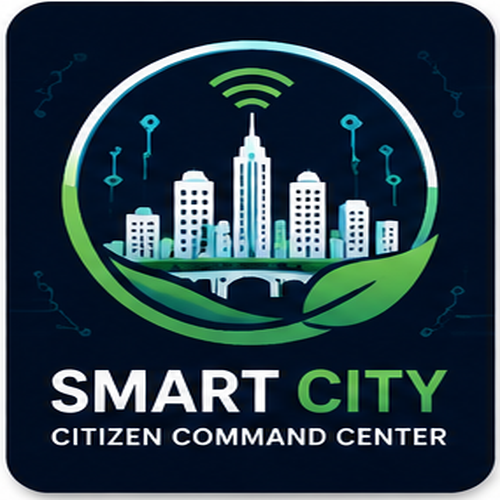
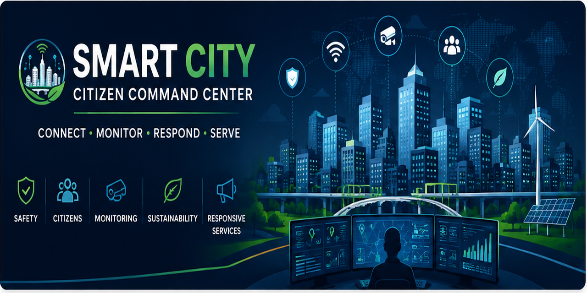

<div align="center">





# Smart Kolkata · Citizen Command Center

**One live nervous system for a city.**
Citizens report. Crews respond. Command sees everything, as it happens.

</div>

---

## The system

Smart Kolkata links three desks to one real-time core:

- **Citizen:** report a problem in seconds, follow it to the fix, back proposals and vote on what the zone needs.
- **Field crew:** live work orders, target lock on the next job, service-window countdowns.
- **City Command:** dispatch, review, the Staff Desk and the city's full audit trail.

## Signals

- **Live everywhere.** One change reaches every open screen at once: the file, the map, the 3D city, the top bar and the inbox.
- **City Health.** Air quality from CPCB stations, traffic from TomTom and rain and heat from Open-Meteo, across 16 places in Kolkata.
- **3D city plate.** The command view is a living model of Kolkata, with zone beacons and live readings.
- **Zone lock.** New citizens lock onto their home zone on a live map, and the dashboard opens there.
- **Privacy by design.** Every response is masked by role, citizens never see staff identities, and sessions live in secure httpOnly cookies.
- **Nothing disappears.** Removed reports, hidden posts and every decision stay in the audit trail.

## Stack

React + Vite · Node.js + Express · MongoDB · Socket.io · Firebase (Google sign-in) · Three.js · Leaflet

## Run it

```
cd backend  && npm install && npm run dev
cd frontend && npm install && npm run dev
```

Copy each folder's `.env.example` to `.env` (backend) or `.env.local` (frontend) and fill in your own values. Never commit them.
Full setup, every setting and the API are in [`frontend/docs/backend/BACKEND-HANDOVER.md`](frontend/docs/backend/BACKEND-HANDOVER.md).

## Team · Group D

| Member | Part |
|---|---|
| **Koushik Bhowmik** | Frontend and command interface, backend rebuild and system integration: real-time core, privacy, City Health, Staff Desk, Community and Notifications |
| **Priti Sarkar** | Backend foundations: sessions, Google sign-in, staff requests, City Health providers |
| **Sayan Majumder** | Sign-in, users and profiles |
| **Subhomoy Ghosh** | Community and Notifications: the original module and its API design |
| **Swarup Sutradhar** | City map: routing, search and zone pinning |
| **Taras Hembram** | Project support |

<div align="center">

*Six people, one live system.*

</div>

---

<div align="center">

*Built for Kolkata. Live by design.*

</div>